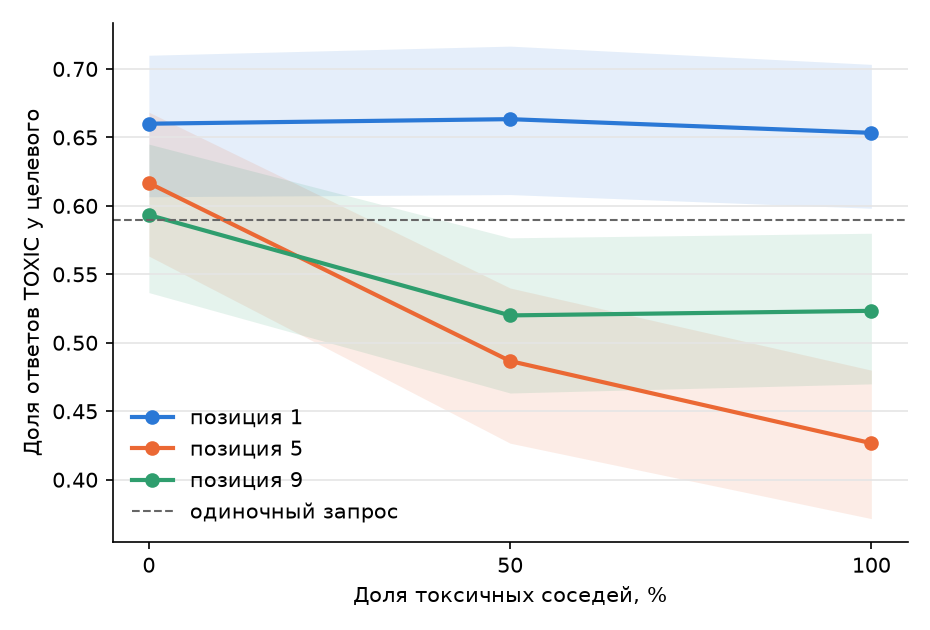
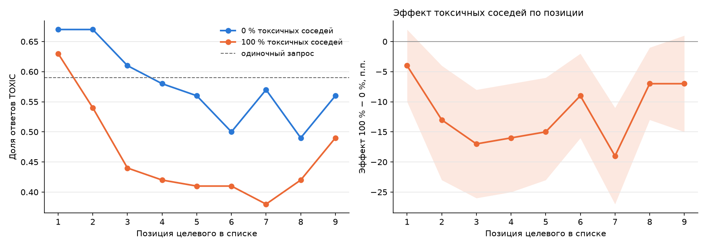

**Гипотеза H1:** чем больше токсичных соседей, тем чаще модель называет целевой комментарий токсичным.

Я пока попробовала прогнать только первую гипотезу через GigaChat Lite. Остальные гипотезы еще не трогала.

## Что сделано

**Выборка (ноутбук `01`).** Оставлены комментарии с ≥ 10 разметчиками, 15–60 слов (после фильтров 165 095). По разметке выделены три группы: явно токсичные (`target ≥ 0,8`), явно нетоксичные (`target = 0`) и спорные (`0,4–0,6`). Взято:
- 300 целевых: 75 явно токсичных + 75 явно нетоксичных + 150 спорных
- 800 соседей: 400 токсичных + 400 нетоксичных, не пересекаются с целевыми.

**План батчей (ноутбук `02`).** Батч = 1 целевой + 8 соседей. Доля токсичных соседей 0 / 25 / 50 / 75 / 100 %, на каждый уровень 3 повтора с разными соседями: 300 × 5 × 3 = 4 500 батчей. Чтобы эффект не объяснялся посторонними причинами:
- соседи подобраны по длине (по числу токенов в пределах ±15 % от длины целевого; у 99 % целевых так и получилось), и средняя длина батча одинакова на всех уровнях (~353 токена);
- наборы соседей вложены друг в друга, при переходе от 25 % к 50 % меняются только два соседа;
- сосед не из той же статьи (`article_id`), что целевой;
- позиция целевого в списке 1, 5 или 9.

**Прогон (ноутбук `03`).** Модель отвечает построчно `<номер>: TOXIC / NOT_TOXIC`, температура ≈ 0, каждый из 1 100 комментариев также классифицирован в одиночку.

**Анализ (ноутбук `04`).** Сдвиг = ответ в батче − одиночный ответ. Основной тест: логистическая регрессия `y_batch ~ доля_токсичных + одиночный_ответ + позиция` с кластеризацией по целевому комментарию (15 батчей одного текста зависимы), плюс тест Макнемара и бутстреп-интервалы по целевым.


## Результат на GigaChat Lite

Одиночная точность относительно разметки 77,3 % (модель склонна к лишним TOXIC, у явно нетоксичных целевых 28 % называет токсичными).

| Доля токсичных соседей | 0 % | 25 % | 50 % | 75 % | 100 % |
|---|---|---|---|---|---|
| Доля ответов TOXIC у целевого | 0,630 | 0,607 | 0,570 | 0,558 | 0,541 |
| Одиночный запрос (те же тексты) | 0,590 | 0,590 | 0,590 | 0,591 | 0,591 |


**H1 не подтвердилась: эффект значимый, но обратный.** Чем больше токсичных соседей, тем реже модель называет целевой текст токсичным.
- Если рядом нет токсичных соседей, модель называет целевой текст токсичным в 63 % случаев, если все 8 соседей токсичные — в 54 %. Разница около 9 процентных пунктов; с учётом погрешности реальная разница лежит где-то между 7 и 12 пунктами, то есть «нулевая разница» (нет эффекта) в этот диапазон не попадает. Поэтому случайностью это объяснить трудно (p < 0,001).
- Тот же результат в других единицах (шансы, odds ratio): шанс получить ответ TOXIC при 100 % токсичных соседей примерно вдвое ниже, чем при 0 % (отношение шансов 0,50; 95 % доверительный интервал 0,42–0,60). Расчёт учитывает, что 15 батчей одного целевого текста зависимы друг от друга.
- По Макнемару при 0 % токсичных соседей 28 текстов стали TOXIC и 10 стали NOT (p = 0,005); при 100 % — 13 и 28 (p = 0,03).
- Наклон схож в группах, спорные −9,4 п.п., явные −8,9 п.п. Меняет ответ меньшинство целевых: при переходе 0 → 100 % у 74 текстов токсичность снизилась, у 213 не изменилась, у 13 выросла.
- Сам переход от одиночного запроса к батчу меняет 14–18 % ответов даже при 0 % токсичных соседей.

**Предварительное наблюдение.** Эффект зависит от места целевого в списке: на позиции 1 он почти нулевой (−2,0 п.п., p = 0,07), на позициях 5 и 9 - около -13 и -12 п.п. Но в основном дизайне позиция совпадала с номером повтора (то есть с набором соседей), поэтому я проверила это отдельно (H1b и H1c ниже).

## Позиция целевого (H1b и H1c)

Тоже только GigaChat Lite. Здесь соседи и их порядок фиксированы, а целевой ставится на разные места, так что позиция не смешана с набором соседей.

**H1b** (ноутбуки `05`, `06`). 300 целевых, доля токсичных соседей 0 / 50 / 100 %, позиции 1, 5, 9: 300 × 3 × 3 = 2 700 батчей.
- Эффект «100 % - 0 %» зависит от позиции: на позиции 1 около 0 п.п., на 5 около −19 п.п., на 9 около −7 п.п. Тест на взаимодействие «доля токсичных * позиция» значим (p ≈ 1e-10).
- Сама позиция тоже влияет (p = 0,001).



**H1c** (проверка на 100 целевых, все 9 позиций, уровни 0 и 100 %, 100 * 2 * 9 = 1 800 батчей; 25 явно токсичных, 25 явно нетоксичных, 50 спорных). Ноутбуки `07`, `08` (пока закинула в `.gitignore` хахахахах).
Но результаты там были такие:

| Позиция целевого | 1 | 2 | 3 | 4 | 5 | 6 | 7 | 8 | 9 |
|---|---|---|---|---|---|---|---|---|---|
| Эффект 100 % − 0 %, п.п. | −4 | −13 | −17 | −16 | −15 | −9 | −19 | −7 | −7 |

- Эффект отрицательный на всех 9 позициях (контраст сохраняется), в среднем около −12 п.п. (доля TOXIC 57,9 % при 0 % токсичных соседей и 46,0 % при 100 %). Только на позициях 1 и 9 доверительный интервал включает 0.
- Края слабее середины, как и в H1b. Конкретные различия между соседними позициями (например, 6 и 7)
- Позиция влияет и сама по себе: даже без токсичных соседей доля TOXIC падает с 67 % на позиции 1 до ~50–57 % на позициях 8–9.
- Контраст есть и у явно токсичных (от 67 % к 55 %), и у явно нетоксичных (от 49 % к 37 %).




## Как запустить

```
python -m venv .venv
.venv\Scripts\activate
pip install -r requirements.txt
copy .env.example .env      
jupyter lab
```
