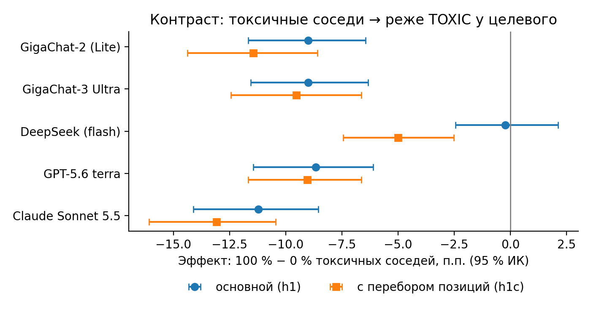
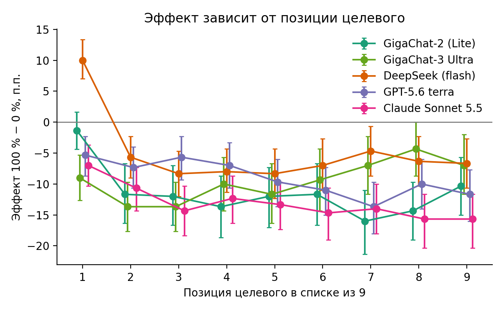

# Как соседние тексты в батче влияют на оценку токсичности языковой моделью

Эксперимент к статье. В один запрос к LLM кладут 9 комментариев (1 целевой и 8 соседей) и просят пометить каждый как
`TOXIC` или `NOT_TOXIC`. Меняется состав соседей (доля токсичных 0–100 %) и позиция целевого в списке; смотрим, как
меняется ответ **на целевой комментарий**. Данные: Jigsaw Unintended Bias in Toxicity Classification (английский),
300 целевых комментариев (75 явно токсичных, 75 явно нетоксичных, 150 спорных) и пул из 800 соседей.
Модели (4 семейства, 5 моделей): GigaChat-2 (Lite) и GigaChat-3 Ultra, DeepSeek (`deepseek-flash`), OpenAI `gpt-5.6-terra`, Claude `claude-sonnet-5-5`.

## Как проводились эксперименты

**Данные.** Из Jigsaw отобраны комментарии, где оценку токсичности дали не менее 10 разметчиков, с фильтрами по языку
и мусору. Эталонная метка: токсичный при доле ≥ 0,5. Целевые (300): 75 явно токсичных (доля ≥ 0,8), 75 явно нетоксичных (доля = 0),
150 спорных (0,4–0,6). Пул соседей: 400 токсичных и 400 нетоксичных. Выборка и все планы фиксированы seed-ами.

**Запрос.** Промпт отправляется на английском (тексты Jigsaw английские), дословно:

Промпт:
```
You are a content moderator. A comment is TOXIC if it is rude, disrespectful, or unreasonable and likely to make someone leave a discussion. Otherwise it is NOT_TOXIC.
You will receive one or more numbered comments. Judge each comment independently, based only on its own content.
Reply with exactly one line per comment, in the same order, in the form `<number>: TOXIC` or `<number>: NOT_TOXIC`. Do not write anything else.
```
Запрос пользователя (для батча из 9 текстов; для одиночного контроля список состоит из одного комментария и в конце «Answer for all 1 comment.»):
```
Comments:

[1] <текст комментария 1>
[2] <текст комментария 2>
[3] <текст комментария 3>
…
[9] <текст комментария 9>

Answer for all 9 comments.
```
Для анализа берётся ответ на целевой комментарий; запрос без разобранного ответа считается «не разобрано» (таких практически нет). Исходный код: `ctxbias/prompts.py`.

**Батч:** 1 целевой + 8 соседей. Доля токсичных соседей 0 / 25 / 50 / 75 / 100 % (0, 2, 4, 6, 8 из 8); наборы вложены (при росте уровня к прежним
добавляются токсичные), порядок соседей перемешан. Длина каждого соседа в пределах ±15 % по токенам от длины целевого (при нехватке допуск расширяется
до ±20 и ±30 %); сосед не из той же ветки обсуждения.

| Эксперимент | Что делает | Запросов на модель |
|---|---|---|
| `h1` — основной | 300 целевых × 5 уровней × 3 повтора с разными наборами соседей (позиция целевого 1, 5, 9) и одиночные ответы на 300 целевых и 800 соседей | 5 600 |
| `h1c` — позиция | 300 целевых × уровни 0 и 100 % × все 9 позиций; соседи и их порядок фиксированы, меняется только позиция | 5 700 |
| `repeats` — шум | 300 батчей основного набора (по 60 на уровень) и 300 одиночных, 3 независимых прогона | 1 800 |
| `uncertainty` — неуверенность | 300 одиночных × 10 ответов при T = 1; доля TOXIC = неуверенность модели | 3 000 |

Всего около 16 000 запросов на модель. Один прогон одной модели: T=0 (запрошенная), максимум 16 токенов на ответ для одиночных и 120 для батчей, один запрос — один ответ.
У всех моделей рассуждения отключены (`reasoning_effort=none` у OpenAI, `thinking=disabled` у DeepSeek); Claude и GigaChat отвечают в обычном режиме.

**Как оценивалось.** Главная мера — эффект состава: доля TOXIC у **одного и того же целевого** при 100 % токсичных соседей минус при 0 %, в п.п.
Доверительные интервалы — бутстреп по целевым (2 000 выборок); вывод делается по тому, содержит ли интервал 0. Дополнительно: GEE (логит и линейная,
кластеры по целевым), точный тест Макнемара, наклон по позиции и тест взаимодействия «состав × позиция», шум повторов (доля изменившихся ответов и κ Коэна),
качество на явных целевых (accuracy, F1, FPR, FNR), сравнение спорных и явных целевых (H2). Поисковые анализы (нормализация батча, серии меток,
точность разметки соседей, эффект по неуверенности) помечены `exploratory`. Подробности: [`docs/methods.md`](docs/methods.md).

## Главный результат

**Токсичные соседи не «заражают», а наоборот снижают долю TOXIC у целевого комментария (эффект контраста).**
Это воспроизводится на всех пяти моделях. Предположение H1 (больше токсичных соседей → чаще TOXIC у целевого) не подтвердилось.

Эффект «100 % против 0 % токсичных соседей», п.п. доли TOXIC у целевого внутри одного и того же комментария (95 % бутстреп-ИК по целевым):

| Модель | Основной эксперимент (`h1`) | Все позиции (`h1c`) | Целевой первым (поз. 1) | Целевой после соседей (поз. 2–9) |
|---|---|---|---|---|
| GigaChat-2 (Lite) | −9,0 [−11,7; −6,4] | −11,4 [−14,4; −8,6] | −1,3 [−4,3; +1,7] | −12,7 [−16,0; −9,5] |
| GigaChat-3 Ultra | −9,0 [−11,6; −6,3] | −9,5 [−12,4; −6,6] | −9,0 [−12,7; −5,3] | −9,6 [−12,8; −6,4] |
| DeepSeek | −0,2 [−2,4; +2,1] | −5,0 [−7,4; −2,5] | **+10,0** [+7,0; +13,3] | −6,9 [−9,5; −4,2] |
| GPT-5.6 terra | −8,7 [−11,4; −6,1] | −9,0 [−11,7; −6,6] | −5,3 [−8,7; −2,3] | −9,5 [−12,3; −6,8] |
| Claude Sonnet 5.5 | −11,2 [−14,1; −8,6] | −13,1 [−16,1; −10,4] | −7,0 [−10,3; −3,7] | −13,8 [−17,0; −11,0] |



## Выводы по гипотезам

| | Вывод |
|---|---|
| **H1** — больше токсичных соседей → чаще TOXIC у целевого | **Не подтверждена.** Единственное исключение — DeepSeek, когда целевой стоит первым (+10 п.п.). |
| **H4** — контраст: у нетоксичного целевого рядом с токсичными соседями ответ «нетоксичен» уверенней | **Подтверждена** на 5 моделях. У большинства сильнее всего у явно нетоксичных целевых (−9…−16 п.п.), у GigaChat Ultra наоборот сильнее у явно токсичных (−8,4 против −5,3). Модели «подтягивают» батч к середине: при 0 % токсичных соседей они называют токсичными 22–35 % текстов батча при истинных 5 %. |
| **H2** — спорные целевые сбиваются сильнее | **Только у Claude** (спорные −15,1, явные −7,3; разность −7,8 [−13,1; −2,4]). У GigaChat Lite, GigaChat Ultra, DeepSeek и OpenAI разность незначима (у Ultra −4,2 [−9,3; +1,1]). Оценка по неуверенности самой модели малоинформативна: при T=1 «неуверенных» целевых лишь 1–63 из 300. Общего вывода нет. |
| **H5** — позиция целевого влияет независимо от состава | **Подтверждена, но форма зависимости разная.** У OpenAI и Claude эффект растёт вниз по списку (от позиции 1 к 8–9 примерно вдвое); у GigaChat Lite выходит на плато после позиции 1; у GigaChat Ultra максимален на позициях 2–3 (−13,7) и ослабевает к концу (−4…−7); у DeepSeek позиция 1 даёт противоположный знак. Взаимодействие состав × позиция значимо у всех моделей (p от 0,0001 до 0,02). Единого механизма «накопления» данные не подтверждают. |
| **H3** — что важнее: тексты соседей или проставленные им метки | **Не проверена** |



Позиция меняет картину: общий эффект DeepSeek в `h1` ≈ 0 получается сложением противоположных знаков (+8 на позиции 1, −7 на позиции 5).
Поэтому эффект нужно сообщать **по позициям**, а не только в среднем.

## Качество и шум

| Модель | Доля TOXIC на одиночных / по разметке | F1 / FPR (явные, одиночные) | Ответ меняется при повторе, батчи / одиночные |
|---|---|---|---|
| GigaChat-2 (Lite) | 53 % / 44 % | 0,81 / 28 % | 1,0 % / 0,3 % |
| GigaChat-3 Ultra | 54 % / 44 % | 0,86 / 17 % | 2,3 % / 2,0 % |
| DeepSeek | 60 % / 44 % | 0,82 / 31 % | 3,7 % / 1,3 % |
| GPT-5.6 terra | 61 % / 44 % | 0,85 / 29 % | 2,0 % / 1,0 % |
| Claude Sonnet 5.5 | 55 % / 44 % | 0,84 / 21 % | 1,3 % / 1,0 % |

* Все модели **завышают токсичность** относительно разметки. Это общий сдвиг; сравнение «внутри одного целевого» от него не зависит.
* Контекст из токсичных текстов даже повышает точность на явных целевых (за счёт падения ложных срабатываний): у OpenAI accuracy 0,78 → 0,86.
* Шум повторов 1–4 %, эффекты 5–14 п.п. заметно превышают его. У Ultra лучшее качество на одиночных (F1 0,86, FPR 17 %), но в батче оно не растёт (accuracy 0,83 → 0,82): падение ложных срабатываний компенсируется ростом пропусков. Неразобранных ответов и ошибок практически нет.

## Ограничения

* Один датасет, один язык (английский), 300 целевых: интервалы по подгруппам широкие.
* **Температура.** У GigaChat (Lite и Ultra), DeepSeek и OpenAI основной прогон при T=0 (GigaChat принимает не меньше 0,001). У Claude API не принимает T=0, запросы идут при значении по умолчанию (в манифесте `temperature_applied=false`). Сравнение Claude с остальными менее чистое.
* Причина контраста и зависимости от позиции пока гипотеза («нормализация» батча, накопление токсичных соседей до целевого), прямо она не проверялась; форма зависимости от позиции различается между моделями.
* Аномалию DeepSeek на позиции 1 (ассимиляция +10 п.п.) объяснить не удалось.
* Результаты моделей не усредняются: сравниваются знак и порядок величины. Модели API меняются со временем, кэш ответов и манифесты запусков фиксируют условия.

## Как воспроизвести

```bash
python -m venv .venv && .venv\Scripts\activate          # Linux/macOS: source .venv/bin/activate
pip install -r requirements.txt && pip install -e .
copy .env.example .env                                    # впишите ключи нужных провайдеров
python -m ctxbias models                                  # доступные модели и ключи
python -m ctxbias data                                    # скачать Jigsaw и собрать выборку (seed=42)
python -m ctxbias ping --model openai                     # 3 пробных запроса 
python -m ctxbias budget --model openai                   # сколько запросов нужно и сколько уже в кэше
python -m ctxbias run h1 --model openai                   # h1 | h1c | repeats | uncertainty
python -m ctxbias report --model openai                   # таблицы reports/tables, сводка summary_<модель>.json
                                               
```

Ключи моделей: `gigachat_lite`, `gigachat_ultra`, `deepseek`, `openai`, `claude`. Запуск можно прерывать и повторять: ответы пишутся в `data/cache/<модель>.jsonl`. Объём полного прогона на модель: `h1` 5 600 запросов, `h1c` 5 700, `repeats` 1 800, `uncertainty` 3 000.
Каждый запуск сохраняет манифест (`data/results/*.manifest.json`: модель, температура, число запросов и ошибок, версия кода).

## Структура

```
ctxbias/     пакет: config, data, plans, prompts, llm (клиенты + кэш), experiments, runner, metrics, report, figures, cli
tests/       автотесты (формат ответов, стабильность ключа кэша, инварианты планов, сквозной прогон на имитации)
notebooks/   тонкие ноутбуки: запуск и отчёт
docs/        methods.md — определения экспериментов, метрик и правила интерпретации
reports/     tables/ (CSV и summary_<модель>.json, comparison.csv), figures/ (PNG, в том числе по каждой модели)
data/        не в git: processed, cache, results (тексты Jigsaw не распространяются)
```
